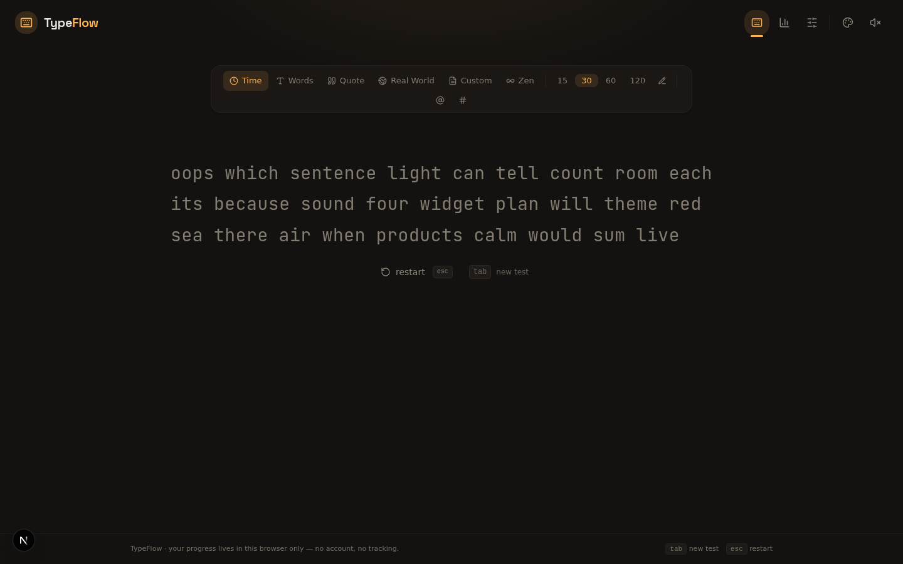
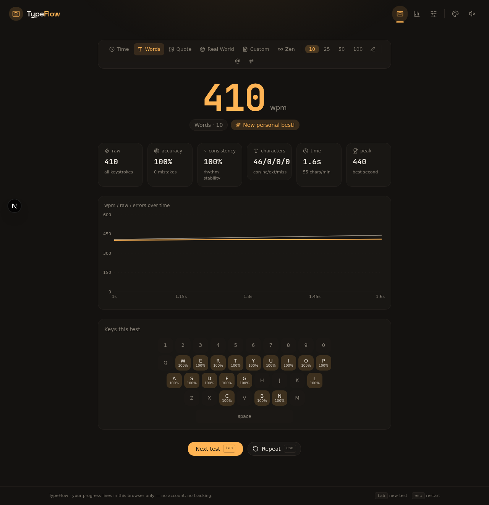

<div align="center">


# TypeFlow

**A modern, feature-rich typing practice & speed-test app — a supercharged take on [monkeytype.com](https://monkeytype.com).**

[](https://nextjs.org)
[](https://www.typescriptlang.org)
[](https://tailwindcss.com)
[](LICENSE)

[Live Demo](#-live-demo) · [Features](#-features) · [Screenshots](#-screenshots) · [Getting Started](#-getting-started) · [Shortcuts](#%EF%B8%8F-keyboard-shortcuts)

</div>

---



## 🚀 Live Demo

> **TODO:** After you deploy (see below), replace this line with your real link, e.g.
> **Try it live: <https://prime-programmer-ar.github.io/typeflow/>** (or your Vercel URL)

The easiest way to get a public URL is the one-click deploy button:

[](https://vercel.com/new/clone?repository-url=https%3A%2F%2Fgithub.com%2Fprime-programmer-ar%2Ftypeflow)

(For GitHub Pages, the app needs a static export — a Vercel/Netlify deploy works out of the box with this Next.js project.)

## ✨ Features

### Six test modes

| Mode | What it does |
| --- | --- |
| **Time** | 15 / 30 / 60 / 120 s — or any custom duration (1–3600 s) |
| **Words** | 10 / 25 / 50 / 100 — or any custom count (1–1000) |
| **Quote** | Famous quotes (short / medium / long / all) with source attribution |
| **Real World** | Real-world sentence practice across 6 categories — Everyday, Tech, Literature, Movies, Idioms, Business — or Mixed |
| **Custom** | Paste your own text (poem, code, lyrics…) and practice on it |
| **Zen** | Free typing with a live WPM readout — finish whenever you like |

### Options & flexibility

- Punctuation & numbers injection for word/time tests
- Stop-on-error and blind mode
- 3 typing fonts, font-size slider (18–40 px), 3 caret styles (line / block / underline), smooth caret
- Live WPM readout and a **live per-second chart** while you type
- Pace-caret ghost that races against your personal best
- Synthesized keystroke sounds (no audio assets) with volume control
- Click **anywhere** on the page (or press any key) to focus the typing area

### 📊 Stats & visuals

- Result screen: WPM, raw speed, accuracy, consistency, character breakdown, and a per-second WPM/raw/error graph
- **Keyboard heatmap** of your accuracy per key
- Dashboard: recent-tests trend chart, 28-day activity calendar, PB cards, full deletable history, all-time per-key stats
- Personal bests tracked per mode / amount / punctuation / numbers combination
- Daily streak tracking

### 🎨 Themes

15 hand-tuned themes (13 dark + 2 light), applied instantly everywhere — UI, charts and heatmap included:

Ember · Carbon · Matrix · Dracula · Nord · Tokyo Night · Gruvbox · Rosé Pine · Catppuccin · Solarized Dark · Everforest · Kanagawa · Synthwave · Paper · Solarized Light

## 📸 Screenshots

| Typing test | Results |
| :---: | :---: |
|  |  |

## 💾 No-login progress persistence

All progress (results, PBs, streaks, per-key stats, settings) is stored in your browser's `localStorage` — **no account, no server, no tracking**. Because the data lives in the browser, it survives reloads and stays with you on that device automatically, even when the site is hosted online.

Use **Settings → Export backup** to move progress between devices/browsers (a plain JSON file you can import anywhere).

## 🚀 Getting Started

```bash
# 1. install dependencies (any Node 20+ package manager; bun recommended)
bun install            # or: npm install

# 2. (optional) set up the local database file
cp .env.example .env
bun run db:push        # or: npx prisma db push

# 3. start the dev server
bun run dev            # or: npm run dev
```

Open <http://localhost:3000> and start typing.

### Production

```bash
bun run build
bun run start          # serves the standalone build
```

Deploy anywhere Node runs (Vercel, Netlify, Railway, a VPS…). The app is fully client-side after load, so it also works behind any static cache/CDN.

## ⌨️ Keyboard Shortcuts

| Key | Action |
| --- | --- |
| <kbd>tab</kbd> | New test (fresh words) |
| <kbd>esc</kbd> | Restart current test |
| <kbd>ctrl</kbd>/<kbd>⌘</kbd> + <kbd>enter</kbd> | Finish a zen session |

## 📁 Project Structure

```
src/
  app/               # layout, page (app shell), global theme CSS
  components/typing/ # ConfigBar, TypingArea, Results, StatsView, SettingsView, Header, charts
  hooks/             # useTypingSession (reducer-driven typing engine)
  lib/typing/        # words, sentences, engine math, themes, storage, sound, types
prisma/              # schema (unused by the typing app — reserved for future server features)
public/              # static assets
docs/                # screenshots
```

## 🛠 Tech Stack

- [Next.js 16](https://nextjs.org) + [TypeScript](https://www.typescriptlang.org)
- [Tailwind CSS 4](https://tailwindcss.com) + [shadcn/ui](https://ui.shadcn.com)
- [Recharts](https://recharts.org) for live & result charts · [Framer Motion](https://www.framer.com/motion/) for view transitions
- CSS-custom-property theming — zero runtime cost

## 🤝 Contributing

Issues and pull requests are welcome! See [CONTRIBUTING.md](CONTRIBUTING.md).

## 📄 License

Released under the [MIT License](LICENSE).
